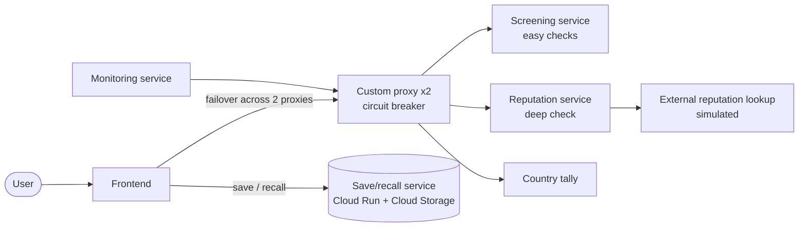

# QUBCloud-FraudGuard

A cloud-native fraud-screening system for a payment processor, built as a set of small stateless microservices. A batch of transactions goes in, and each one comes back as `OK`, `SUSPICIOUS` or `ERROR`, with a reason.

Built for the MSc Software Development module CSC7071 Cloud Computing at Queen's University Belfast. The brief was less about writing fraud logic and more about making and defending architectural decisions: how to split services, how to route and fail over, how to monitor, and where to put state.

## Architecture

The stateless core runs on Kubernetes on QPC (QUB's private cloud). The one stateful feature, saving and recalling batches, runs on Google Cloud because QPC has no persistent storage.

## Repositories

| Repository | What it does |
| --- | --- |
| [fgfrontend40270840](https://github.com/QUBFraudGuard/fgfrontend40270840) | Web page: paste transactions, screen, tally by country, save and recall |
| [fgproxy40270840](https://github.com/QUBFraudGuard/fgproxy40270840) | Custom reverse proxy with runtime-configurable routes and a circuit breaker |
| [fgscreeningservice40270840](https://github.com/QUBFraudGuard/fgscreeningservice40270840) | Easy checks: amount threshold, blocklist, country rule. Includes the CI test suite |
| [fgreputationservice40270840](https://github.com/QUBFraudGuard/fgreputationservice40270840) | Deep check: risk score from an external lookup, failing closed on errors |
| [externalreputationlookup40270840](https://github.com/QUBFraudGuard/externalreputationlookup40270840) | Simulated third-party reputation API used by the reputation service |
| [fgcountrytally40270840](https://github.com/QUBFraudGuard/fgcountrytally40270840) | Node.js service that counts transactions per country |
| [fgmonitoringservice40270840](https://github.com/QUBFraudGuard/fgmonitoringservice40270840) | Sends a known test batch on demand and every 60 seconds, checks the results, and alerts on failure |
| [fgsaverecall40270840](https://github.com/QUBFraudGuard/fgsaverecall40270840) | Saves a batch to Cloud Storage and returns an ID; recalls it by ID |

## Key decisions

Every decision gave something up. These are the ones I made and the trade-off I accepted.

| Decision | Chosen | Trade-off accepted |
| --- | --- | --- |
| Test coverage | Unit tests per check, mocked reputation lookup, input validation tested once in the orchestrator | Network failure fails closed (flags `SUSPICIOUS`), so outages block legitimate transactions |
| How to split screening | By hardness: easy checks in one service, the slow external lookup in another | Less cohesion in the easy-check service; lost cross-check short-circuiting |
| Proxy configuration | Config file (Kubernetes ConfigMap), reloaded on every request | Manual upkeep and guarding against bad config |
| Frontend failover | Failover only across two proxy endpoints | Idle capacity, and one request is lost per failure |
| Proxy resilience | Circuit breaker with a half-open probe | Requests are refused during cool-down even if the backend recovered |
| Persistence | Object store (Cloud Storage), keyed by ID | No searching or querying saved batches |

## Results

- A 200-transaction batch took about 14 seconds through the unsplit service.
- After splitting by hardness, the easy checks responded in about 0.2 seconds. The reputation lookup was the slow part (around 44 seconds at first), and concurrent lookups brought it down to about 3 seconds.
- The monitoring service ran periodic checks, then caught a forced failure of the reputation service and logged an alert.
- The circuit breaker opened after 3 consecutive failures, refused calls during a 15-second cool-down, then probed the backend before closing.

## Tech

Python (Flask), Node.js, JavaScript, Docker, Kubernetes (Rancher on QPC), GitLab CI, pytest, Google Cloud Run, Google Cloud Storage.

## Known limitations

- The save and recall endpoints have no authentication, which would need fixing before production.
- Monitoring alerts only appear in pod logs, with no push notifications.
- Batch IDs are truncated UUIDs, which risks collisions at scale.
- The services were deployed on QPC, which is only accessible from within the university, so there are no public live demos.

## Author

Emma Sloan, MSc Software Development, Queen's University Belfast.
